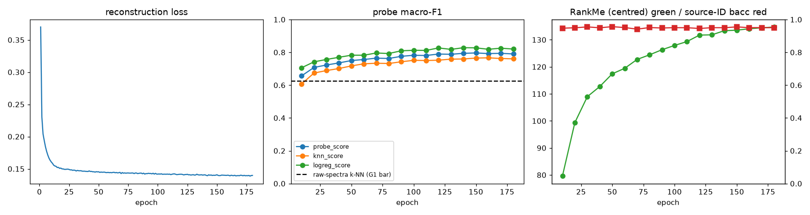
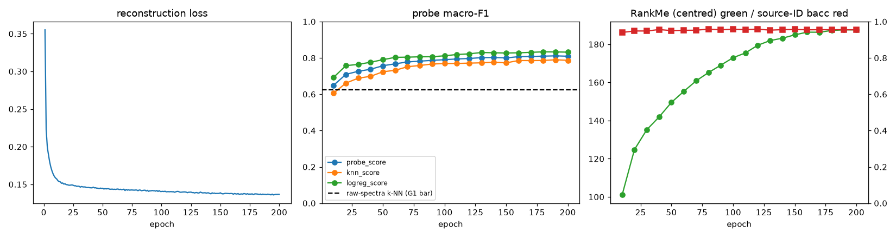

# Foundation model A: base (full) run vs small run

**Compiled:** 2026-11-03 · **Branch:** `amosj` · **Base results commit:** `a85ba27`

This report covers the full run of the **base** model A (14.6M parameters), from pretraining through adaptation to the one-time test pass. It compares every stage with the **small** model A (5.0M parameters), which was the model behind the first results (`foundation/results/adaptation.md`).

The only thing that changed between the two runs is the model size (`preset`). Everything else is identical: the corpus, the pretraining settings, the adaptation settings, the learning-rate grids, the seeds and the test sets.

| | small | base |
|---|---|---|
| pretraining run | `20261003-123546_small_main` | `20261029-014608_base_main` |
| pretrain config | `foundation/configs/pretrain_main.yaml` | `foundation/configs/pretrain_main_base.yaml` |
| adapt config | `foundation/configs/adapt.yaml` | `foundation/configs/adapt_base.yaml` |
| adaptation runs | `foundation/runs/adapt/` | `foundation/runs/adapt_base/` |
| test report | `foundation/results/adaptation.md` | `foundation/results/base/adaptation.md` |

---

## 1. Summary

1. **Pretraining:** base scores slightly higher on the pretraining probe (0.811 vs 0.796), and its embeddings use more dimensions (RankMe 187.5 vs 133.5). It was also still improving at the end: its best checkpoint is from epoch 190 of 200, while small levelled off at 150. The probe gap is inside the 0.03 margin the project treats as noise.
2. **Test accuracy:** paired on the same test spectra, base and small are **statistically the same in 6 of 8 task/arm combinations**. The two clear differences point in **opposite directions**, and both involve B2 (LoRA):
   - T1 B2: base is **+1.57 points** better (95% CI [+0.10, +3.14]).
   - T2 B2: base is **−1.38 points** worse (95% CI [−2.36, −0.30]).
3. **The pre-registered questions change in base's favour.** With base, B2 beats training from scratch on T1 (Q1, which small missed), and a cheap add-on gets within 1 point of the best arm on both tasks (Q3 is a **PASS**; it was a FAIL for small).
4. **Cost:** base has 2.9 times as many parameters, a checkpoint 2.8 times larger (58 MB vs 20 MB), pretraining that takes 1.7 times as long (7.5 h vs 4.5 h), adaptation runs that take about 1.5–2 times as long, and about twice the spread between seeds.
5. **Conclusion:** the larger model does **not** give a better model A overall. Small matches it on accuracy at a third of the cost and with more stable seeds. Base is only worth it if the target is a LoRA-only (B2) deployment on T1-like data, the one setting where it is clearly better.

---

## 2. Models

| | small | base |
|---|---|---|
| encoder layers / width / heads / FF | 6 / 256 / 8 / 1024 | 8 / 384 / 8 / 1536 |
| encoder parameters | 4,987,744 | 14,568,160 |
| `ckpt_best.pt` size | 19.99 MB | 58.32 MB |
| stem | masked GroupNorm | masked GroupNorm |

---

## 3. Pretraining

Both runs use the same settings: masked-spectrum pretraining on `corpus_v1`, batch size 512, LR 3e-4 with 10 warm-up epochs then cosine decay, up to 200 epochs, a probe every 10 epochs, and an early stop if the probe stays flat for 3 checks.

| | small | base | base − small |
|---|---|---|---|
| epochs run | 180 / 200 (early stop) | 200 / 200 | +20 |
| how it ended | probe flat for 3 checkpoints | reached max_epochs | |
| wall time (RTX 3060) | 4.5 h | 7.5 h | ×1.7 |
| best epoch | 150 | 190 | +40 |
| final reconstruction loss | 0.140 (epoch 180) | 0.137 (epoch 200) | −0.003 |
| **probe score** | 0.796 | **0.811** | +0.015 |
| k-NN / logreg | 0.765 / 0.827 | 0.790 / 0.833 | +0.025 / +0.006 |
| RankMe (centred) | 133.5 | **187.5** | +54 |
| source-ID balanced acc | 0.955 | 0.955 | 0 |
| airborne (kNN / LR) | 0.96 / 0.99 | 0.98 / 0.99 | +0.02 / 0 |
| RRUFF (kNN / LR) | 0.57 / 0.67 | 0.60 / 0.68 | +0.03 / +0.01 |
| G1 (beats raw-spectra k-NN 0.625) | PASS | PASS | |

**Probe score by epoch:**

| epoch | 10 | 20 | 40 | 60 | 80 | 100 | 120 | 140 | 150 | 160 | 180 | 190 | 200 |
|---|---|---|---|---|---|---|---|---|---|---|---|---|---|
| small | 0.656 | 0.708 | 0.736 | 0.756 | 0.762 | 0.782 | 0.790 | 0.794 | **0.796** | 0.793 | 0.790 | – | – |
| base | 0.649 | 0.709 | 0.738 | 0.768 | 0.782 | 0.790 | 0.797 | 0.802 | 0.800 | 0.807 | 0.810 | **0.811** | 0.809 |

What the pretraining shows:
- For the first 20 epochs the two models are level. From about epoch 50, base pulls ahead by 0.01–0.02 and stays ahead.
- Small plateaued around epoch 150. Base kept improving slowly until 190. A longer schedule might help base further, but the last 30 epochs only added +0.004.
- RankMe goes up the most: base's embeddings spread over many more dimensions. As section 4 shows, this **did not** turn into better linear-probe accuracy on our tasks.


*Small: reconstruction loss, probe macro-F1, and RankMe / source-ID.*


*Base: the same three panels.*

---

## 4. Adaptation: test results

### 4.1 Test accuracy (mean ± sd over 5 seeds)

T1 has 3,000 test spectra (30 classes). T2 has 2,500 spectra (the 2019 clinical set, 5 classes).

| task | arm | small | base | base − small |
|---|---|---|---|---|
| T1 | S (from scratch) | 80.94 ± 0.68 | 81.30 ± 1.37 | +0.36 |
| T1 | LP (linear probe) | 78.24 ± 0.23 | 78.10 ± 0.42 | −0.14 |
| T1 | B1 (full fine-tune) | **83.13** ± 0.63 | 82.87 ± 1.22 | −0.26 |
| T1 | B2 (LoRA) | 81.89 ± 0.63 | **83.47** ± 1.51 | **+1.57** |
| T2 | S (from scratch) | 87.78 ± 0.68 | 86.43 ± 2.42 | −1.35 |
| T2 | LP (linear probe) | 86.78 ± 0.63 | 87.88 ± 0.68 | +1.10 |
| T2 | B1 (full fine-tune) | 89.58 ± 0.51 | 89.57 ± 1.16 | −0.01 |
| T2 | B2 (LoRA) | **91.90** ± 0.56 | 90.52 ± 1.27 | **−1.38** |

Macro-F1 follows accuracy closely for every arm. The values are in each model's own report.

### 4.2 Paired comparison: base vs small

The two test passes scored the **same test spectra** (checked: the `y_test.npy` files are identical), so the models can be compared spectrum by spectrum. The method is the one the project uses for its arm comparisons:
- **diff:** base − small accuracy, averaged over the 5 seeds (seed *k* of base paired with seed *k* of small).
- **CI:** a 95% bootstrap interval that resamples seeds and test spectra together (`foundation.stats.bootstrap_diff`, 10,000 resamples).
- **McNemar:** an exact per-seed test (`foundation.stats.mcnemar`).

| task | arm | diff (points) | 95% CI | verdict | McNemar p per seed |
|---|---|---|---|---|---|
| T1 | S | +0.36 | [−1.07, +1.85] | no clear difference | 0.385, 0.0326, 0.0516, 5.8e-05, 0.0721 |
| T1 | LP | −0.14 | [−1.35, +1.09] | no clear difference | 0.26, 1, 0.415, 0.879, 0.611 |
| T1 | B1 | −0.26 | [−1.59, +1.04] | no clear difference | 0.193, 0.437, 0.0035, 0.383, 0.0214 |
| T1 | **B2** | **+1.57** | **[+0.10, +3.14]** | **base better** | 3.0e-07, 0.899, 0.441, 0.462, 1.1e-10 |
| T2 | S | −1.35 | [−3.25, +0.47] | no clear difference | 0.0124, 1.2e-13, 9.4e-05, 0.452, 0.0598 |
| T2 | LP | +1.10 | [−0.20, +2.43] | no clear difference | 0.891, 0.00088, 0.104, 1.5e-05, 0.619 |
| T2 | B1 | −0.01 | [−1.03, +0.98] | no clear difference | 0.478, 0.935, 0.0654, 0.0424, 0.171 |
| T2 | **B2** | **−1.38** | **[−2.36, −0.30]** | **small better** | 4.5e-04, 0.014, 1.1e-06, 3.8e-04, 0.407 |

How to read this:
- **Only B2 differs clearly, and in opposite directions on the two tasks.** That is a sign of task-specific variance, not of one model being better.
- **Even the significant B2 results are uneven across seeds.** On T1, base B2 wins strongly on seeds 1 and 5 (85.2 vs 82.0 and 84.9 vs 81.3) and is level on seeds 2–4, so two good seeds carry the mean. On T2, small B2 is ahead on seeds 1–4 and base is ahead only on seed 5.
- **Many single-seed McNemar p-values are small even where the 5-seed CI crosses 0.** The two models make different mistakes, but neither makes fewer overall.
- **S does not use model A at all.** It trains the same architecture from random weights, so the S rows compare a 15M against a 5M network trained only on our data, and measure nothing about pretraining. Neither size is clearly better on S.

### 4.3 Pre-registered questions (spec 8.3)

| question | small | base |
|---|---|---|
| Q1 T1 B1 vs S | +2.19 [1.01, 3.37] → met | +1.57 [0.07, 3.10] → met |
| Q1 T1 B2 vs S | +0.95 [−0.26, 2.18] → **not met** | +2.17 [0.35, 3.92] → **met** |
| Q1 T2 B1 vs S | +1.79 [0.90, 2.70] → met | +3.14 [0.83, 5.55] → met |
| Q1 T2 B2 vs S | +4.11 [3.03, 5.22] → met | +4.09 [1.89, 5.98] → met |
| Q2 T1 B1 vs B2 | +1.23 [0.31, 2.15]: B1 better | −0.60 [−1.73, 0.48]: no clear difference |
| Q2 T2 B1 vs B2 | −2.32 [−3.29, −1.34]: B2 better | −0.95 [−2.29, 0.30]: no clear difference |
| Q3 B2 (within 1 point of best, ≤ 5% trainable) | **FAIL** (1.23 below B1 on T1) | **PASS** (best arm on both tasks) |
| Q3 LP | FAIL | FAIL |
| **Q3 overall** | **FAIL** | **PASS** |

With base, all four Q1 comparisons are met and Q3 passes. The pre-registered story ("A helps, and a cheap LoRA add-on is enough") holds cleanly only with base.

Two caveats. First, the Q3 flip comes mostly from **T1 B2 going up by 1.6 points** while T1 B1 stayed flat. Second, the 1-point Q3 margin is about the size of base's seed-to-seed spread (sd 1.2–1.5 on T1).

### 4.4 Data-efficiency curve (T1 stage ii, 3 seeds)

Test accuracy when only *n* spectra per class are used in T1's second training stage.

| spectra / class | S small | S base | B1 small | B1 base | B2 small | B2 base |
|---|---|---|---|---|---|---|
| 5 | 76.37 | **78.39** | 80.53 | 79.84 | 80.14 | 80.88 |
| 10 | 79.12 | **80.99** | 81.17 | 80.88 | 81.68 | 82.32 |
| 25 | 81.69 | 81.67 | 83.06 | 82.91 | 81.90 | 82.07 |
| 50 | 81.34 | 81.48 | 83.27 | 82.27 | 81.60 | **83.40** |
| all | 81.08 | 80.43 | 83.43 | 82.38 | 82.18 | 83.42 |

Paired base − small differences that are clear (95% CI excludes 0):

| setting | diff | 95% CI |
|---|---|---|
| S, 5 per class | +2.02 | [+0.96, +3.03] |
| S, 10 per class | +1.87 | [+0.81, +2.94] |
| B2, 50 per class | +1.80 | [+0.10, +3.39] |

Every other curve point has a CI that crosses 0.

So the bigger architecture **trained from scratch** does better with very little data (5–10 per class). Once pretrained and fine-tuned (B1), the two sizes are indistinguishable at every data size. B2 is slightly better with base at every size, but clearly so only at 50 per class.

### 4.5 Validation vs test

During the run, validation accuracy pointed the wrong way for some arms. On T1 validation, base looked **3.0 points worse on LP** (90.1 vs 93.1) and **1.5 worse on B1** (93.9 vs 95.5). On test those gaps all but disappear (−0.14 and −0.26).

T1 validation has only 300 spectra (10 per class), and T2 validation is at the ceiling (≥ 98.5%) for every arm. Neither is reliable for telling the two sizes apart. Only the test pass is.

### 4.6 Learning rates selected (3-value sweep on seed 1)

| arm | T1 small | T1 base | T2 small | T2 base |
|---|---|---|---|---|
| S | 3e-4 | 3e-4 | 1e-3 | 1e-3 |
| LP | 1e-2 | 1e-2 | 1e-2 | 1e-2 |
| B1 | 1e-4 | **1e-3** | 3e-4 | **1e-4** |
| B2 | 1e-3 | 1e-3 | 1e-3 | 1e-3 |

Only B1 changed. On T1, base picked the **top** of B1's grid where small picked the bottom. Several choices sit at an edge of their grid. As with small, the grids were not extended, so every arm has the same tuning budget.

---

## 5. Cost

| | small | base | ratio |
|---|---|---|---|
| encoder parameters | 4.99M | 14.57M | ×2.9 |
| model A file | 19.99 MB | 58.32 MB | ×2.9 |
| pretraining time | 4.5 h | 7.5 h | ×1.7 |
| GPU memory during pretraining | not recorded | ~10.5 GB of 12 GB | |
| T1 run time S / LP / B1 / B2 (min) | 13.6 / 4.8 / 7.9 / 8.7 | 23.3 / 7.4 / 12.1 / 15.1 | ×1.5–1.7 |
| T2 run time S / LP / B1 / B2 (min) | 2.1 / 0.8 / 1.0 / 1.5 | 3.3 / 1.2 / 2.0 / 2.6 | ×1.5–2 |
| B2 add-on (T1 / T2) | 975 kB / 949 kB | 1.91 MB / 1.87 MB | ×2 |
| B2 trainable share (T1 / T2) | 4.52% / 4.40% | 3.11% / 3.05% | |
| test-acc sd over seeds (T1 B1 / B2) | 0.63 / 0.63 | 1.22 / 1.51 | ×2–2.4 |

The full base run took about 17 hours of GPU time end to end: 7.5 h pretraining, 3.3 h LR sweep, 4.6 h seeds, plus the curve and the test pass.

---

## 6. Conclusions and recommendation

- **Bigger did not mean better at adaptation.** Base improved the pretraining probe by 0.015 and raised RankMe a lot. On the actual tasks, though, it is a tie with small in 6 of 8 comparisons, with one clear win and one clear loss.
- **Base makes the pre-registered results cleaner (Q1 all met, Q3 PASS).** That is a real but narrow gain. It rests mainly on T1 B2 (+1.6 points), and base's runs are about twice as variable between seeds.
- **Keep small as the default model A.** It gives the same accuracy for about a third of the storage, about 60% of the compute and half the variance between seeds. Use base only if the deliverable specifically needs the B2 (LoRA) add-on on T1-style data, or if the story depends on passing Q3.
- **A larger model trained from scratch helps at very low data** (+2 points at 5–10 spectra per class). This is an effect of model size, separate from pretraining.

## 7. Limitations

- **Each size has a single pretraining run (seed 0).** Variation between pretraining seeds isn't measured, so part of the base–small difference could come from that single pretraining seed rather than from model size.
- **Learning rates were picked on validation sets that are small (T1) or saturated (T2)**, from 3-value grids with several picks at an edge. A finer sweep could change individual arms by about 1 point, which is the size of the effects in this report.
- **The paired base-vs-small statistics in section 4.2 were computed for this report.** They use the same functions as the official reports, but they are not part of either report's pre-registered questions.
- **Base was never run as a 50-epoch trial on the current stem**, so the decision to run it was not gated on a trial. The older base trial, run before the GroupNorm fix, came out level with small (0.672 vs 0.672).

## Reproduce

```
venv/Scripts/python.exe -m foundation.pretrain --config foundation/configs/pretrain_main_base.yaml
venv/Scripts/python.exe -m foundation.adapt sweep --config foundation/configs/adapt_base.yaml
venv/Scripts/python.exe -m foundation.adapt seeds --config foundation/configs/adapt_base.yaml
venv/Scripts/python.exe -m foundation.adapt curve --config foundation/configs/adapt_base.yaml
venv/Scripts/python.exe -m foundation.evaluate --config foundation/configs/adapt_base.yaml --results foundation/results/base   # once only
```

The paired base-vs-small numbers in section 4.2 come from `bootstrap_diff(base_correct, small_correct)` and `mcnemar` in `foundation/stats.py`. Both are computed on the per-seed predictions saved in `foundation/runs/{adapt,adapt_base}/final_test/<task>/<arm>_seed<k>.npy`.
