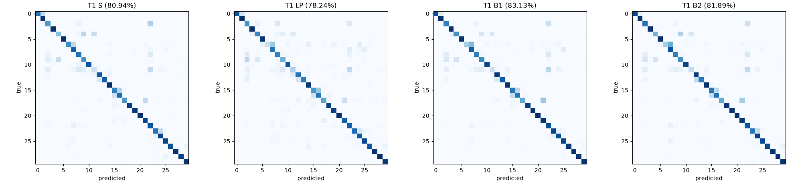
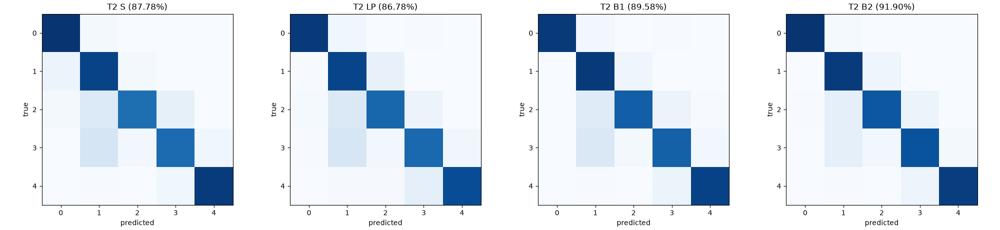

# Foundation experiment: adaptation results

Model A: `foundation/runs/pretrain/20261003-123546_small_main/ckpt_best.pt` (19.99 MB). Test sets scored once (spec section 7, phase 4). Accuracies in %; mean +- sd over seeds [1, 2, 3, 4, 5].

**Known limitation (spec 8.4):** one pretraining run of A; variation between pretraining seeds is not measured.

## T1

| arm | LR | val acc | test acc | macro-F1 | trainable | add-on | time per run |
|---|---|---|---|---|---|---|---|
| S | 3e-04 | 93.60 | 80.94 +- 0.68 | 80.43 +- 0.75 | 4,995,454 (100.00%) | 20.02 MB | 13.6 min |
| LP | 1e-02 | 93.13 | 78.24 +- 0.23 | 77.51 +- 0.29 | 7,710 (0.15%) | 32.6 kB | 4.8 min |
| B1 | 1e-04 | 95.47 | 83.13 +- 0.63 | 82.31 +- 0.78 | 4,995,454 (100.00%) | 20.02 MB | 7.9 min |
| B2 | 1e-03 | 94.13 | 81.89 +- 0.63 | 81.01 +- 0.86 | 235,742 (4.52%) | 974.6 kB | 8.7 min |

| comparison | diff (points) | 95% bootstrap CI | McNemar p per seed |
|---|---|---|---|
| B1 vs S | 2.19 | [1.01, 3.37] | 8.49e-07, 1.73e-05, 0.0846, 0.00692, 0.00204 |
| B2 vs S | 0.95 | [-0.26, 2.18] | 0.0287, 0.000638, 0.573, 0.0349, 1 |
| B1 vs B2 | 1.23 | [0.31, 2.15] | 0.00109, 0.27, 0.0138, 0.418, 0.00043 |

Per-class recall (%, pooled over seeds):

| class | S | LP | B1 | B2 |
|---|---|---|---|---|
| 0 | 73.6 | 83.4 | 87.0 | 90.6 |
| 1 | 98.0 | 100.0 | 100.0 | 100.0 |
| 2 | 58.8 | 61.8 | 68.4 | 73.6 |
| 3 | 99.8 | 100.0 | 100.0 | 100.0 |
| 4 | 41.8 | 65.8 | 62.4 | 47.8 |
| 5 | 100.0 | 98.0 | 99.4 | 99.6 |
| 6 | 63.4 | 21.8 | 35.4 | 34.8 |
| 7 | 82.0 | 73.2 | 81.0 | 86.6 |
| 8 | 73.8 | 67.4 | 69.4 | 69.4 |
| 9 | 62.2 | 48.4 | 64.6 | 62.0 |
| 10 | 86.0 | 85.8 | 92.0 | 92.2 |
| 11 | 21.0 | 32.0 | 22.0 | 23.6 |
| 12 | 82.6 | 74.0 | 96.8 | 95.8 |
| 13 | 81.8 | 70.2 | 82.0 | 70.0 |
| 14 | 99.2 | 96.4 | 98.6 | 98.8 |
| 15 | 68.0 | 59.6 | 71.2 | 72.2 |
| 16 | 76.8 | 73.8 | 73.0 | 73.8 |
| 17 | 59.6 | 53.8 | 51.4 | 51.6 |
| 18 | 93.8 | 94.2 | 95.2 | 96.6 |
| 19 | 97.2 | 93.0 | 98.8 | 98.8 |
| 20 | 99.2 | 100.0 | 100.0 | 99.0 |
| 21 | 91.4 | 81.6 | 97.4 | 96.4 |
| 22 | 85.6 | 82.6 | 87.6 | 84.4 |
| 23 | 74.4 | 76.8 | 90.0 | 72.2 |
| 24 | 91.4 | 84.8 | 88.0 | 93.6 |
| 25 | 91.6 | 89.6 | 91.2 | 89.2 |
| 26 | 86.0 | 84.2 | 96.2 | 90.0 |
| 27 | 99.0 | 98.6 | 98.8 | 99.0 |
| 28 | 92.6 | 100.0 | 97.2 | 97.4 |
| 29 | 97.6 | 96.4 | 98.8 | 97.8 |

## T2

| arm | LR | val acc | test acc | macro-F1 | trainable | add-on | time per run |
|---|---|---|---|---|---|---|---|
| S | 1e-03 | 98.54 | 87.78 +- 0.68 | 87.71 +- 0.65 | 4,989,029 (100.00%) | 19.99 MB | 2.1 min |
| LP | 1e-02 | 98.74 | 86.78 +- 0.63 | 86.91 +- 0.61 | 1,285 (0.03%) | 7.0 kB | 0.8 min |
| B1 | 3e-04 | 99.08 | 89.58 +- 0.51 | 89.68 +- 0.49 | 4,989,029 (100.00%) | 19.99 MB | 1.0 min |
| B2 | 1e-03 | 99.10 | 91.90 +- 0.56 | 91.92 +- 0.55 | 229,317 (4.40%) | 948.9 kB | 1.5 min |

| comparison | diff (points) | 95% bootstrap CI | McNemar p per seed |
|---|---|---|---|
| B1 vs S | 1.79 | [0.90, 2.70] | 0.00153, 0.000364, 0.000372, 0.00433, 0.0636 |
| B2 vs S | 4.11 | [3.03, 5.22] | 2.75e-09, 2.09e-07, 6.91e-20, 3.35e-18, 2.23e-13 |
| B1 vs B2 | -2.32 | [-3.29, -1.34] | 0.000421, 0.0222, 8.75e-10, 8.28e-13, 2.95e-09 |

Per-class recall (%, pooled over seeds):

| class | S | LP | B1 | B2 |
|---|---|---|---|---|
| 0 | 98.1 | 95.8 | 96.2 | 98.0 |
| 2 | 92.2 | 92.2 | 95.9 | 95.7 |
| 3 | 75.9 | 79.0 | 81.9 | 85.1 |
| 5 | 77.2 | 78.2 | 81.0 | 86.4 |
| 6 | 95.5 | 88.7 | 92.8 | 94.4 |

## Pre-registered questions (spec 8.3)

- **Q1** T1 B1 vs S: 2.19 points, CI [1.01, 3.37] -> A helps (success)
- **Q1** T1 B2 vs S: 0.95 points, CI [-0.26, 2.18] -> no clear difference (not met)
- **Q1** T2 B1 vs S: 1.79 points, CI [0.90, 2.70] -> A helps (success)
- **Q1** T2 B2 vs S: 4.11 points, CI [3.03, 5.22] -> A helps (success)
- **Q2** T1 B1 vs B2: 1.23 points, CI [0.31, 2.15]; B1 trains 21.2x B2's parameters
- **Q2** T2 B1 vs B2: -2.32 points, CI [-3.29, -1.34]; B1 trains 21.8x B2's parameters
- **Q3** B2: FAIL (T1: 1.23 points below best, 4.52% trainable; T2: 0.00 points below best, 4.40% trainable)
- **Q3** LP: FAIL (T1: 4.89 points below best, 0.15% trainable; T2: 5.11 points below best, 0.03% trainable)
- **Q3 overall: FAIL**

## Reuse deliverable (spec 6.3)

One A file (19.99 MB) serves both tasks; each task stores only its add-on.

| task | arm | add-on | trainable | test acc |
|---|---|---|---|---|
| T1 | LP | 32.6 kB | 7,710 | 78.24 |
| T1 | B2 | 974.6 kB | 235,742 | 81.89 |
| T2 | LP | 7.0 kB | 1,285 | 86.78 |
| T2 | B2 | 948.9 kB | 229,317 | 91.90 |

## Data-efficiency curve (spec 8.5, T1 stage ii)

| spectra per class | S | B1 | B2 |
|---|---|---|---|
| 5 | 76.37 +- 1.77 | 80.53 +- 0.50 | 80.14 +- 1.06 |
| 10 | 79.12 +- 1.19 | 81.17 +- 0.48 | 81.68 +- 1.82 |
| 25 | 81.69 +- 0.78 | 83.06 +- 0.33 | 81.90 +- 0.86 |
| 50 | 81.34 +- 0.77 | 83.27 +- 0.15 | 81.60 +- 0.58 |
| all | 81.08 +- 0.78 | 83.43 +- 0.40 | 82.18 +- 0.66 |

## Notes

- **Selected learning rates** (3-value sweep on seed 1, selected on validation only; spec 6.2). An asterisk marks a choice at the edge of the arm's grid. Per the plan the grids were **not** extended, so every arm keeps the same tuning budget; an arm picked at an edge may do better at an untried LR.

  | arm | grid | T1 | T2 |
  |---|---|---|---|
  | S | 1e-4, 3e-4, 1e-3 | 3e-4 | 1e-3 * (top) |
  | LP | 1e-3, 3e-3, 1e-2 | 1e-2 * (top) | 1e-2 * (top) |
  | B1 | 1e-4, 3e-4, 1e-3 | 1e-4 * (bottom) | 3e-4 |
  | B2 | 1e-3, 3e-3, 1e-2 (10x B1, spec 6.1) | 1e-3 * (bottom) | 1e-3 * (bottom) |

- **S also uses layer-wise LR decay 0.75** (plan D6: spec 6.1 gives S "the same schedule as B1's unfrozen phase"). This slightly favours a pretrained start; S's own LR sweep partly offsets it.
- **T2 validation is near ceiling** (98.5–99.1% for every arm) because it is a random 10% of the 2018 data; LR choice on T2 was therefore decided mostly by validation loss (plan D2). The 2019 test set is the real measure of T2.
- **Q3 margin:** B2 is 1.23 points below B1 on T1, just outside the pre-registered 1.0-point margin, and the best arm on T2. Q3 is reported as FAIL as pre-registered.
- **Curve "all" row** uses seeds 1–3 only (the curve's seeds), so it differs slightly from the 5-seed T1 table above. Curve runs reuse stage i from the full-data run (plan D11).
- **Run integrity:** every one of the 76 scored models reproduced its own validation predictions exactly before its test predictions were made, and every run was trained on the same model A file (SHA-1 checked at scoring).
