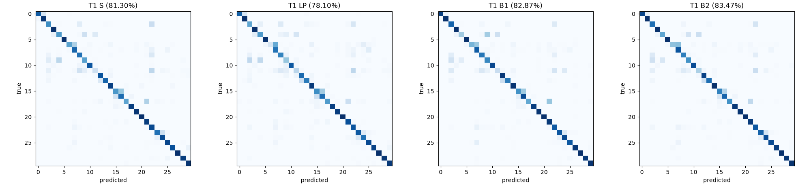
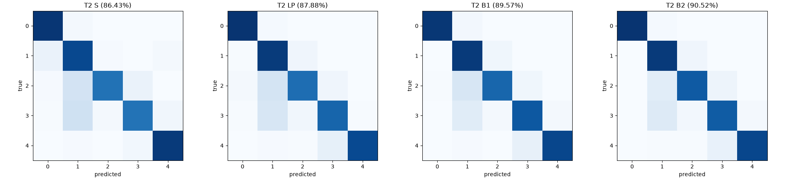

# Foundation experiment: adaptation results

Model A: `foundation/runs/pretrain/20261029-014608_base_main/ckpt_best.pt` (58.32 MB). Test sets scored once (spec section 7, phase 4). Accuracies in %; mean +- sd over seeds [1, 2, 3, 4, 5].

**Known limitation (spec 8.4):** one pretraining run of A; variation between pretraining seeds is not measured.

## T1

| arm | LR | val acc | test acc | macro-F1 | trainable | add-on | time per run |
|---|---|---|---|---|---|---|---|
| S | 3e-04 | 94.33 | 81.30 +- 1.37 | 80.66 +- 1.50 | 14,579,710 (100.00%) | 58.36 MB | 23.3 min |
| LP | 1e-02 | 90.13 | 78.10 +- 0.42 | 77.14 +- 0.52 | 11,550 (0.08%) | 48.0 kB | 7.4 min |
| B1 | 1e-03 | 93.93 | 82.87 +- 1.22 | 81.99 +- 1.57 | 14,579,710 (100.00%) | 58.36 MB | 12.1 min |
| B2 | 1e-03 | 94.07 | 83.47 +- 1.51 | 82.96 +- 1.58 | 467,166 (3.11%) | 1.91 MB | 15.1 min |

| comparison | diff (points) | 95% bootstrap CI | McNemar p per seed |
|---|---|---|---|
| B1 vs S | 1.57 | [0.07, 3.10] | 0.0021, 4.88e-08, 0.744, 0.788, 0.000637 |
| B2 vs S | 2.17 | [0.35, 3.92] | 1.02e-10, 1.96e-08, 0.0671, 0.253, 4.2e-05 |
| B1 vs B2 | -0.60 | [-1.73, 0.48] | 9.03e-05, 1, 0.126, 0.405, 0.502 |

Per-class recall (%, pooled over seeds):

| class | S | LP | B1 | B2 |
|---|---|---|---|---|
| 0 | 83.6 | 81.6 | 94.2 | 91.8 |
| 1 | 97.6 | 100.0 | 99.6 | 100.0 |
| 2 | 64.2 | 53.4 | 80.0 | 75.4 |
| 3 | 100.0 | 100.0 | 100.0 | 99.6 |
| 4 | 58.6 | 57.8 | 36.2 | 53.2 |
| 5 | 100.0 | 99.0 | 99.4 | 100.0 |
| 6 | 54.8 | 16.4 | 46.8 | 41.2 |
| 7 | 79.6 | 74.2 | 83.0 | 86.0 |
| 8 | 74.8 | 67.8 | 72.8 | 69.8 |
| 9 | 56.2 | 39.0 | 66.6 | 62.2 |
| 10 | 85.2 | 84.4 | 90.8 | 89.4 |
| 11 | 20.4 | 28.4 | 23.4 | 33.0 |
| 12 | 86.6 | 77.6 | 96.8 | 93.2 |
| 13 | 79.8 | 71.0 | 71.4 | 75.8 |
| 14 | 93.6 | 96.0 | 98.4 | 100.0 |
| 15 | 59.8 | 64.0 | 62.2 | 68.2 |
| 16 | 77.0 | 76.4 | 89.6 | 79.8 |
| 17 | 54.4 | 58.2 | 52.4 | 62.2 |
| 18 | 94.2 | 94.0 | 94.4 | 96.8 |
| 19 | 97.4 | 94.6 | 98.0 | 98.0 |
| 20 | 99.6 | 100.0 | 99.4 | 99.8 |
| 21 | 94.8 | 88.0 | 96.4 | 95.4 |
| 22 | 90.4 | 85.6 | 83.6 | 84.4 |
| 23 | 75.2 | 84.6 | 85.2 | 80.6 |
| 24 | 89.6 | 74.8 | 90.4 | 88.8 |
| 25 | 91.6 | 90.2 | 84.6 | 89.6 |
| 26 | 88.0 | 92.6 | 96.6 | 94.6 |
| 27 | 99.6 | 100.0 | 99.8 | 99.6 |
| 28 | 94.6 | 97.2 | 95.8 | 97.0 |
| 29 | 97.8 | 96.2 | 98.2 | 98.6 |

## T2

| arm | LR | val acc | test acc | macro-F1 | trainable | add-on | time per run |
|---|---|---|---|---|---|---|---|
| S | 1e-03 | 98.70 | 86.43 +- 2.42 | 86.45 +- 2.43 | 14,570,085 (100.00%) | 58.32 MB | 3.3 min |
| LP | 1e-02 | 98.98 | 87.88 +- 0.68 | 87.99 +- 0.66 | 1,925 (0.01%) | 9.5 kB | 1.2 min |
| B1 | 1e-04 | 99.20 | 89.57 +- 1.16 | 89.68 +- 1.09 | 14,570,085 (100.00%) | 58.32 MB | 2.0 min |
| B2 | 1e-03 | 99.16 | 90.52 +- 1.27 | 90.59 +- 1.23 | 457,541 (3.05%) | 1.87 MB | 2.6 min |

| comparison | diff (points) | 95% bootstrap CI | McNemar p per seed |
|---|---|---|---|
| B1 vs S | 3.14 | [0.83, 5.55] | 0.944, 1.1e-22, 2.81e-15, 0.126, 2.07e-06 |
| B2 vs S | 4.09 | [1.89, 5.98] | 0.779, 6.09e-23, 4.11e-13, 3.28e-11, 2.11e-18 |
| B1 vs B2 | -0.95 | [-2.29, 0.30] | 0.839, 0.929, 0.481, 3.79e-09, 2.52e-07 |

Per-class recall (%, pooled over seeds):

| class | S | LP | B1 | B2 |
|---|---|---|---|---|
| 0 | 97.6 | 98.2 | 97.1 | 98.4 |
| 2 | 90.4 | 95.3 | 96.1 | 95.9 |
| 3 | 74.4 | 76.3 | 79.2 | 83.9 |
| 5 | 74.1 | 79.7 | 84.4 | 83.0 |
| 6 | 95.8 | 89.9 | 91.0 | 91.4 |

## Pre-registered questions (spec 8.3)

- **Q1** T1 B1 vs S: 1.57 points, CI [0.07, 3.10] -> A helps (success)
- **Q1** T1 B2 vs S: 2.17 points, CI [0.35, 3.92] -> A helps (success)
- **Q1** T2 B1 vs S: 3.14 points, CI [0.83, 5.55] -> A helps (success)
- **Q1** T2 B2 vs S: 4.09 points, CI [1.89, 5.98] -> A helps (success)
- **Q2** T1 B1 vs B2: -0.60 points, CI [-1.73, 0.48]; B1 trains 31.2x B2's parameters
- **Q2** T2 B1 vs B2: -0.95 points, CI [-2.29, 0.30]; B1 trains 31.8x B2's parameters
- **Q3** B2: PASS (T1: 0.00 points below best, 3.11% trainable; T2: 0.00 points below best, 3.05% trainable)
- **Q3** LP: FAIL (T1: 5.37 points below best, 0.08% trainable; T2: 2.64 points below best, 0.01% trainable)
- **Q3 overall: PASS**

## Reuse deliverable (spec 6.3)

One A file (58.32 MB) serves both tasks; each task stores only its add-on.

| task | arm | add-on | trainable | test acc |
|---|---|---|---|---|
| T1 | LP | 48.0 kB | 11,550 | 78.10 |
| T1 | B2 | 1.91 MB | 467,166 | 83.47 |
| T2 | LP | 9.5 kB | 1,925 | 87.88 |
| T2 | B2 | 1.87 MB | 457,541 | 90.52 |

## Data-efficiency curve (spec 8.5, T1 stage ii)

| spectra per class | S | B1 | B2 |
|---|---|---|---|
| 5 | 78.39 +- 1.49 | 79.84 +- 1.02 | 80.88 +- 0.24 |
| 10 | 80.99 +- 1.42 | 80.88 +- 0.97 | 82.32 +- 0.18 |
| 25 | 81.67 +- 0.90 | 82.91 +- 0.46 | 82.07 +- 1.90 |
| 50 | 81.48 +- 0.97 | 82.27 +- 0.97 | 83.40 +- 1.53 |
| all | 80.43 +- 0.93 | 82.38 +- 1.11 | 83.42 +- 1.61 |
