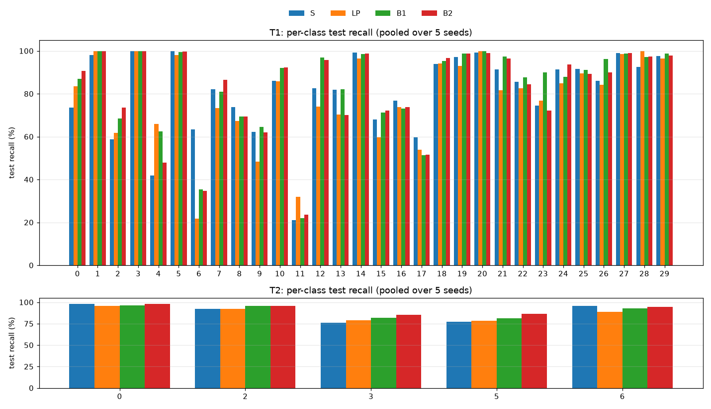
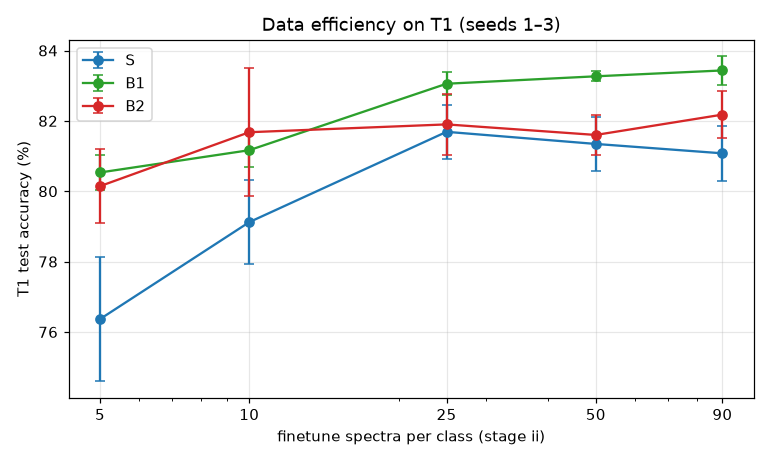

# Raman foundation model (A → B1 / B2): final report

Branch `amosj`. Experiment code in `foundation/`; design in `docs/superpowers/specs/2026-10-01-raman-foundation-model-design.md`; plans 1–3 in `docs/superpowers/plans/`. Every number below is computed from the saved run folders (`foundation/runs/adapt/`) and the single locked test pass (`final_test/scored.json`: status **complete**, 2026-10-03T23:44:05). Accuracies are in %, as mean ± sd over 5 seeds unless stated.

## 1. Summary

**Question.** Can a general model (A), pretrained only on other people's Raman spectra, make our Bacteria-ID classifiers better than training the same network from scratch — either by fine-tuning A (B1) or by training small LoRA adapters on a frozen A (B2)?

**Answer.** Yes, both ideas work.

- **Pretraining helps.** Full fine-tuning (B1) beats from-scratch (S) on both tasks: +2.2 points on T1 and +1.8 on T2, with 95% confidence intervals that exclude zero. LoRA (B2) beats S by +4.1 points on T2; on T1 its +1.0 is not distinguishable from zero.
- **Which branch wins depends on the task.** B1 is best on T1 (83.1%). B2 is best on T2, the 2018 → 2019 shift (91.9%), while training only 4.4% of the parameters.
- **A frozen with only a new head (LP) is not enough.** It is the weakest arm on both tasks (78.2% / 86.8%).
- **One shared A works as a reusable base.** One 20 MB A file serves both tasks, and each task adds a 975 kB (T1) / 949 kB (T2) LoRA add-on.
- **The pre-registered reuse test (Q3) narrowly failed.** B2 is the best arm on T2 but 1.23 points behind B1 on T1, just outside the 1.0-point margin set in advance.
- **Pretraining matters most when labelled data is scarce.** With 5 spectra per class, starting from A gives about +4 points over S.

| arm | what is trained | T1 val | T1 test | T2 val | T2 test |
|---|---|---|---|---|---|
| **S** | everything (random start) | 93.6 ± 0.8 | **80.9 ± 0.7** | 98.5 ± 0.3 | **87.8 ± 0.7** |
| **LP** | head only | 93.1 ± 0.4 | **78.2 ± 0.2** | 98.7 ± 0.2 | **86.8 ± 0.6** |
| **B1** | everything (from A) | 95.5 ± 0.4 | **83.1 ± 0.6** | 99.1 ± 0.4 | **89.6 ± 0.5** |
| **B2** | LoRA + norms + head | 94.1 ± 0.5 | **81.9 ± 0.6** | 99.1 ± 0.1 | **91.9 ± 0.6** |

## 2. What was built

### 2.1 Model A (pretraining, plans 1–2)

- **Corpus:** `corpus_v1` has 242,156 pretraining spectra from 25 public sources (minerals, chemistry, biology; lasers 458–785 nm). They are resampled onto one grid (350–1850 cm⁻¹, step 1.5, 1001 points), each with a validity mask.
- **Leakage guard:** **none of our Bacteria-ID spectra are in A.** A hash plus a near-duplicate check (cosine/Pearson ≥ 0.999) removed 0 spectra, and A's checkpoint was chosen on a probe slice of the corpus, never on our data.
- **Architecture:** a multi-scale CNN stem (kernels 3/9/25, masked GroupNorm) feeds 101 patch tokens of 15 cm⁻¹, each with sinusoidal wavenumber positions, into a 6-layer transformer (width 256, 8 heads; the `small` preset, 4.99 M parameters).
- **Training:** masked-spectrum reconstruction (MAE). Half of the valid tokens are hidden and the clean spectrum is reconstructed from corrupted input (baseline, shift, noise, broadening, spikes).
- **Size trials** (50 epochs each; probe score = mean macro-F1 of k-NN and logistic probes):

  | size | probe score |
  |---|---|
  | tiny | 0.636 |
  | small | 0.672 |
  | base | 0.672 |
  | small + masked GroupNorm | 0.742 |

  The small size with masked GroupNorm was chosen.
- **Main run:** stopped at epoch 180/200, with the best checkpoint at epoch 150.
  - Probe score 0.796 (k-NN 0.765, logistic 0.827), against 0.625 for k-NN on the raw spectra. **Gate G1 passed** by 0.14.
  - It is strong on the bacteria probe (airborne pathogens, k-NN 0.96 / logistic 0.99) and weaker on sharp mineral peaks (RRUFF 0.57 / 0.67).

### 2.2 The two tasks (our data)

| task | train | validation | test | classes |
|---|---|---|---|---|
| **T1** 30 isolates | stage i: reference 54,000; stage ii: finetune 2,700 (90/class) | stage i: reference 6,000; stage ii: finetune 300 (10/class) | test 3000 (100/class) | 30 |
| **T2** clinical | 2018clinical 9,000 | 2018clinical 1,000 | 2019clinical 2500 (500/class) | 5 |

Validation splits are a fixed, stratified 10% of the training files (split seed 0). The test sets are separate files: T1 `test`, and T2 the 2019 clinical file. They were scored **once**, after every run was frozen.

### 2.3 The four arms and how each was trained

| arm | starts from | trained | T1 LoRA rank / trainable | add-on file |
|---|---|---|---|---|
| S | random | everything (random start) | 4,995,454 (100.00%) | 20.0 MB |
| LP | A | head only | 7,710 (0.15%) | 33 kB |
| B1 | A | everything (from A) | 4,995,454 (100.00%) | 20.0 MB |
| B2 | A | LoRA + norms + head | r=8, 235,742 (4.52%) | 975 kB |

Shared recipe for every arm:

- **Optimiser:** AdamW, batch 256, weight decay 0.05, fp16 mixed precision, gradient clip 1.0, a 1-epoch LR warm-up, then cosine decay.
- **Augmentation:** mild — shift ±2 cm⁻¹, scale 0.9–1.1, SNR 30–100.
- **Early stopping:** on validation loss, patience 5. The best epoch is restored at the end of every stage. Stages stop at 30 (T1 stage i) or 50 epochs at most.

Arm-specific rules:

- **B1:** the head is trained alone for 5 epochs (at 10× the LR), then everything with layer-wise LR decay 0.75, so the stem gets the smallest LR.
- **S:** the same schedule as B1's unfrozen phase, including the layer decay.
- **B2:** LoRA (α = 2r, dropout 0.05) on every q/k/v/o and feed-forward layer, plus all norm parameters and the head.
- **T1** trains stage i (reference) and then stage ii (finetune) with the same freeze rule. **T2** trains a single stage.

**Fair tuning:** each arm got the same budget, 3 learning rates on seed 1, chosen on validation only (T1: the stage-ii finetune validation split). The chosen LR was then used for seeds 1–5. An asterisk marks a choice at the edge of the grid.

| arm | grid | T1 val acc per LR | T1 pick | T2 val acc per LR | T2 pick |
|---|---|---|---|---|---|
| S | 1e-04, 3e-04, 1e-03 | 91.7 / 93.3 / 92.7 | 3e-04 | 98.5 / 98.3 / 98.8 | 1e-03 * |
| LP | 1e-03, 3e-03, 1e-02 | 85.0 / 90.0 / 93.0 | 1e-02 * | 97.2 / 98.3 / 98.6 | 1e-02 * |
| B1 | 1e-04, 3e-04, 1e-03 | 95.7 / 94.0 / 94.3 | 1e-04 * | 99.0 / 99.5 / 98.5 | 3e-04 |
| B2 | 1e-03, 3e-03, 1e-02 | 94.7 / 93.0 / 90.3 | 1e-03 * | 99.0 / 98.8 / 98.7 | 1e-03 * |

## 3. Results

### 3.1 Validation vs test

| task | arm | val acc | val macro-F1 | test acc | test macro-F1 | val → test drop |
|---|---|---|---|---|---|---|
| T1 | S | 93.6 ± 0.8 | 93.5 ± 0.9 | 80.9 ± 0.7 | 80.4 ± 0.8 | −12.7 |
| T1 | LP | 93.1 ± 0.4 | 93.1 ± 0.4 | 78.2 ± 0.2 | 77.5 ± 0.3 | −14.9 |
| T1 | B1 | 95.5 ± 0.4 | 95.3 ± 0.4 | 83.1 ± 0.6 | 82.3 ± 0.8 | −12.3 |
| T1 | B2 | 94.1 ± 0.5 | 94.1 ± 0.5 | 81.9 ± 0.6 | 81.0 ± 0.9 | −12.2 |
| T2 | S | 98.5 ± 0.3 | 98.5 ± 0.3 | 87.8 ± 0.7 | 87.7 ± 0.6 | −10.8 |
| T2 | LP | 98.7 ± 0.2 | 98.7 ± 0.2 | 86.8 ± 0.6 | 86.9 ± 0.6 | −12.0 |
| T2 | B1 | 99.1 ± 0.4 | 99.1 ± 0.4 | 89.6 ± 0.5 | 89.7 ± 0.5 | −9.5 |
| T2 | B2 | 99.1 ± 0.1 | 99.1 ± 0.1 | 91.9 ± 0.6 | 91.9 ± 0.5 | −7.2 |

Validation is drawn from the same files as training, so it is much easier than the test sets:

- **T1:** about 94% on validation against 78–83% on test.
- **T2:** about 99% on validation against 87–92% on test.

The real difficulty is therefore the **shift between measurement sets / years**, not the classes themselves. T2 validation is at a ceiling (98.5–99.1% for every arm), so it barely separates the arms. Within each arm the three learning rates were at most 1.4 points apart on T2, so those choices rest on small margins.

### 3.2 Per-seed test results

**T1** — test accuracy (%) per seed

| arm | seed 1 | seed 2 | seed 3 | seed 4 | seed 5 | mean ± sd |
|---|---|---|---|---|---|---|
| S | 80.5 | 80.7 | 82.0 | 80.2 | 81.2 | 80.9 ± 0.7 |
| LP | 78.6 | 78.2 | 78.2 | 77.9 | 78.3 | 78.2 ± 0.2 |
| B1 | 83.8 | 83.5 | 83.0 | 82.1 | 83.2 | 83.1 ± 0.6 |
| B2 | 82.0 | 82.9 | 81.6 | 81.7 | 81.3 | 81.9 ± 0.6 |

**T2** — test accuracy (%) per seed

| arm | seed 1 | seed 2 | seed 3 | seed 4 | seed 5 | mean ± sd |
|---|---|---|---|---|---|---|
| S | 88.0 | 87.8 | 87.4 | 87.0 | 88.8 | 87.8 ± 0.7 |
| LP | 86.9 | 86.4 | 87.4 | 85.9 | 87.4 | 86.8 ± 0.6 |
| B1 | 89.9 | 90.0 | 89.2 | 88.8 | 89.8 | 89.6 ± 0.5 |
| B2 | 91.4 | 91.2 | 92.2 | 92.3 | 92.4 | 91.9 ± 0.6 |

### 3.3 Statistical comparisons (pre-registered)

- **Difference:** mean over seeds of the paired accuracy difference.
- **CI:** 95% bootstrap, resampling seeds and test samples together (10,000 resamples).
- **McNemar:** exact test per paired seed.

| task | comparison | diff (points) | 95% CI | seeds with McNemar p < 0.05 |
|---|---|---|---|---|
| T1 | B1 vs S | 2.19 | [1.01, 3.37] | 4 / 5 |
| T1 | B2 vs S | 0.95 | [-0.26, 2.18] | 3 / 5 |
| T1 | B1 vs B2 | 1.23 | [0.31, 2.15] | 3 / 5 |
| T2 | B1 vs S | 1.79 | [0.90, 2.70] | 4 / 5 |
| T2 | B2 vs S | 4.11 | [3.03, 5.22] | 5 / 5 |
| T2 | B1 vs B2 | -2.32 | [-3.29, -1.34] | 5 / 5 |

| question | result |
|---|---|
| **Q1** T1 B1 vs S: does A help? | A helps — **met** |
| **Q1** T1 B2 vs S: does A help? | no clear difference — not met |
| **Q1** T2 B1 vs S: does A help? | A helps — **met** |
| **Q1** T2 B2 vs S: does A help? | A helps — **met** |
| **Q2** T1 B1 vs B2 | 1.23 points (CI [0.31, 2.15]); B1 trains 21× more parameters |
| **Q2** T2 B1 vs B2 | -2.32 points (CI [-3.29, -1.34]); B1 trains 22× more parameters |
| **Q3** B2 within 1.0 pt of the best on both tasks, ≤ 5% trained | FAIL (T1: 1.23 pts below best; T2: 0.00 pts below best) |
| **Q3** LP within 1.0 pt of the best on both tasks, ≤ 5% trained | FAIL (T1: 4.89 pts below best; T2: 5.11 pts below best) |

## 4. What happened in each arm

Training behaviour, as mean over 5 seeds. "Epochs" counts the epochs run, with the epoch that was restored in brackets. Accuracy at the best epoch is measured on that stage's own validation split (stage i: reference; stage ii / T2: finetune or 2018).

| task | arm | stage | epochs run [best] per seed | val acc at best | train loss / val loss at best | time per stage |
|---|---|---|---|---|---|---|
| T1 | S | stage-i | 22 [17], 30 [26], 24 [19], 29 [24], 30 [27] | 95.2 | 0.118 / 0.139 | 13.2 min |
| T1 | S | stage-ii | 13 [8], 13 [8], 16 [11], 15 [10], 20 [15] | 93.6 | 0.127 / 0.169 | 0.4 min |
| T1 | LP | stage-i | 18 [13], 30 [29], 25 [20], 30 [29], 30 [28] | 91.2 | 0.262 / 0.260 | 4.5 min |
| T1 | LP | stage-ii | 33 [28], 34 [29], 35 [30], 33 [28], 32 [27] | 93.1 | 0.163 / 0.237 | 0.3 min |
| T1 | B1 | stage-i-warmup | 5 [5], 5 [5], 5 [5], 5 [5], 5 [5] | 83.5 | 0.594 / 0.581 | 0.8 min |
| T1 | B1 | stage-i | 13 [8], 14 [9], 14 [9], 12 [7], 12 [7] | 95.2 | 0.130 / 0.142 | 6.6 min |
| T1 | B1 | stage-ii | 14 [9], 17 [12], 18 [13], 24 [19], 18 [13] | 95.5 | 0.073 / 0.161 | 0.5 min |
| T1 | B2 | stage-i | 10 [5], 13 [8], 14 [9], 17 [12], 12 [7] | 95.2 | 0.140 / 0.142 | 8.3 min |
| T1 | B2 | stage-ii | 15 [10], 13 [8], 14 [9], 14 [9], 12 [7] | 94.1 | 0.068 / 0.172 | 0.4 min |
| T2 | S | single | 23 [18], 22 [17], 34 [29], 24 [19], 22 [17] | 98.5 | 0.040 / 0.043 | 2.1 min |
| T2 | LP | single | 33 [28], 26 [21], 33 [28], 20 [15], 32 [27] | 98.7 | 0.057 / 0.047 | 0.8 min |
| T2 | B1 | warmup | 5 [5], 5 [5], 5 [5], 5 [5], 5 [5] | 95.4 | 0.175 / 0.164 | 0.1 min |
| T2 | B1 | single | 17 [12], 12 [7], 7 [2], 10 [5], 9 [4] | 99.1 | 0.025 / 0.029 | 0.9 min |
| T2 | B2 | single | 12 [7], 11 [6], 16 [11], 13 [8], 18 [13] | 99.1 | 0.021 / 0.028 | 1.5 min |

### S — from scratch (the control)

- **Training:** the slowest learner. On T1 stage i it needed 27 epochs on average, and 2 of 5 seeds reached the 30-epoch limit before early stopping could trigger (their best epochs were 26 and 27). So S might gain a little from a longer stage i. Each T1 run took about 14 min, the longest of any arm.
- **Peak validation:** it reaches the same reference-validation accuracy as the pretrained arms (95.2%).
- **Test:** it does worse on the shifted sets: 80.9% on T1 and 87.8% on T2.
- **Behaviour:** the architecture alone is already a strong baseline. Pretraining adds a few points on top of it, rather than rescuing a weak network.

### LP — frozen A with a new linear head

- **What it shows:** what A learned on its own, since only 7,710 (T1) / 1,285 (T2) parameters are trained.
- **Training:** it fits well within each split, reaching 91.2% on reference validation and 93.1% on finetune validation. It converges slowly: 3 of 5 seeds used all 30 stage-i epochs, and stage ii took about 33 epochs. Its learning rate was at the top of the grid on both tasks.
- **Test:** this arm drops most: 78.2% on T1 and 86.8% on T2, 2.7 and 1.0 points below S.
- **Behaviour:** A's frozen features separate the classes inside one measurement set, but they still carry set-specific nuisance that a linear head cannot remove. The encoder has to adapt at least a little to cope with the shift.

### B1 — full fine-tuning of A (branch 1)

- **Warm-up:** 5 epochs with only the head trained took reference validation to 83.5% (T1) and 95.4% (T2) before anything else was unfrozen.
- **Training:** after unfreezing it converges fastest of all arms. T1 stage i stopped after 13 epochs on average, against 27 for S, so a run took about 8 min instead of 14. On T2 it peaks after only 6 full epochs, and one seed peaked at epoch 2. It overfits quickly once everything is trainable, which is why early stopping matters here.
- **Test:** best arm on T1 (83.1%, +2.2 over S). On T2 it scores 89.6%, +1.8 over S but behind B2.
- **Learning rate:** the lowest value in the grid (1e-4) was chosen on T1. The best learning rate for fine-tuning A may be lower still.

### B2 — LoRA on frozen A (branch 2)

- **Setup:** rank 8 adapters plus norm parameters plus the head: 235,742 trainable parameters (4.52%), stored as a 975 kB add-on.
- **Training:** it converges almost as fast as B1 (T1 stage i: 13 epochs) and reaches the same reference validation (95.2%).
- **Test:** best arm on T2 (91.9%, +4.1 over S, and +2.3 over B1, significant in every seed). On T1 it scores 81.9%: +1.0 over S, not significant, and 1.2 behind B1.
- **Behaviour:** keeping A frozen and changing it only through small adapters acts as regularisation. It helps most when the test data comes from a different time (T2) and slightly limits how far the model can specialise on T1.
- **Learning rate:** B2's grid is fixed at 10× B1's by the spec, and B2 picked the bottom of it on both tasks, so it may be slightly under-tuned.

## 5. Per-class recall

Recall (%) per class, pooled over the 5 seeds. *val* is the selection split (T1: finetune validation, 10 spectra × 5 seeds per class; T2: 2018 validation, 200 × 5). *test* is the test set (T1: 100 × 5 per class; T2: 500 × 5).

### T1

| class | S val | S test | LP val | LP test | B1 val | B1 test | B2 val | B2 test | best on test |
|---|---|---|---|---|---|---|---|---|---|
| 0 | 100 | 74 | 100 | 83 | 100 | 87 | 100 | 91 | B2 |
| 1 | 100 | 98 | 100 | 100 | 100 | 100 | 100 | 100 | LP |
| 2 | 60 | 59 | 70 | 62 | 52 | 68 | 60 | 74 | B2 |
| 3 | 98 | 100 | 100 | 100 | 100 | 100 | 96 | 100 | LP |
| 4 | 94 | 42 | 74 | 66 | 90 | 62 | 96 | 48 | LP |
| 5 | 100 | 100 | 100 | 98 | 100 | 99 | 100 | 100 | S |
| 6 | 100 | 63 | 100 | 22 | 100 | 35 | 100 | 35 | S |
| 7 | 84 | 82 | 98 | 73 | 96 | 81 | 86 | 87 | B2 |
| 8 | 90 | 74 | 90 | 67 | 86 | 69 | 88 | 69 | S |
| 9 | 84 | 62 | 92 | 48 | 98 | 65 | 82 | 62 | B1 |
| 10 | 98 | 86 | 100 | 86 | 100 | 92 | 100 | 92 | B2 |
| 11 | 94 | 21 | 90 | 32 | 100 | 22 | 90 | 24 | LP |
| 12 | 100 | 83 | 100 | 74 | 100 | 97 | 100 | 96 | B1 |
| 13 | 100 | 82 | 100 | 70 | 98 | 82 | 100 | 70 | B1 |
| 14 | 100 | 99 | 100 | 96 | 100 | 99 | 100 | 99 | S |
| 15 | 86 | 68 | 76 | 60 | 80 | 71 | 82 | 72 | B2 |
| 16 | 82 | 77 | 90 | 74 | 86 | 73 | 82 | 74 | S |
| 17 | 100 | 60 | 98 | 54 | 100 | 51 | 100 | 52 | S |
| 18 | 100 | 94 | 100 | 94 | 100 | 95 | 100 | 97 | B2 |
| 19 | 94 | 97 | 100 | 93 | 100 | 99 | 100 | 99 | B1 |
| 20 | 96 | 99 | 100 | 100 | 100 | 100 | 98 | 99 | LP |
| 21 | 84 | 91 | 80 | 82 | 90 | 97 | 92 | 96 | B1 |
| 22 | 86 | 86 | 80 | 83 | 90 | 88 | 92 | 84 | B1 |
| 23 | 98 | 74 | 78 | 77 | 100 | 90 | 96 | 72 | B1 |
| 24 | 92 | 91 | 100 | 85 | 98 | 88 | 98 | 94 | B2 |
| 25 | 100 | 92 | 90 | 90 | 100 | 91 | 94 | 89 | S |
| 26 | 100 | 86 | 100 | 84 | 100 | 96 | 100 | 90 | B1 |
| 27 | 96 | 99 | 90 | 99 | 100 | 99 | 100 | 99 | S |
| 28 | 96 | 93 | 100 | 100 | 100 | 97 | 96 | 97 | LP |
| 29 | 96 | 98 | 98 | 96 | 100 | 99 | 96 | 98 | B1 |

Most frequent test confusions (true → predicted, as % of the true class):

- **S:** 2→22 (32%), 15→16 (31%), 4→9 (29%), 6→7 (27%)
- **LP:** 15→16 (39%), 6→7 (37%), 9→2 (28%), 11→22 (27%)
- **B1:** 6→7 (44%), 17→21 (38%), 11→22 (28%), 15→16 (28%)
- **B2:** 6→7 (50%), 17→21 (35%), 4→9 (32%), 15→16 (27%)

### T2

| class | S val | S test | LP val | LP test | B1 val | B1 test | B2 val | B2 test | best on test |
|---|---|---|---|---|---|---|---|---|---|
| 0 | 98 | 98 | 98 | 96 | 99 | 96 | 99 | 98 | S |
| 2 | 98 | 92 | 100 | 92 | 100 | 96 | 99 | 96 | B1 |
| 3 | 98 | 76 | 98 | 79 | 99 | 82 | 99 | 85 | B2 |
| 5 | 99 | 77 | 99 | 78 | 99 | 81 | 99 | 86 | B2 |
| 6 | 100 | 96 | 98 | 89 | 99 | 93 | 99 | 94 | S |

Most frequent test confusions (true → predicted, as % of the true class):

- **S:** 5→2 (17%), 3→2 (14%), 3→5 (8%), 2→0 (6%)
- **LP:** 5→2 (16%), 3→2 (14%), 6→5 (9%), 2→3 (7%)
- **B1:** 5→2 (14%), 3→2 (12%), 6→5 (6%), 3→5 (6%)
- **B2:** 5→2 (9%), 3→2 (9%), 3→5 (5%), 6→5 (5%)

**What the per-class view shows**

- **T1, almost perfect for everyone:** classes 1, 3, 5, 14, 20 and 27 are near 100% for every arm.
- **T1, where A helps most:**
  - class 0: S 74% → B2 91%;
  - class 12: S 83% → B1 97%;
  - class 4: S 42% → LP 66% / B1 62%;
  - class 23: S 74% → B1 90%;
  - classes 21 and 26: about +6 to +10 points.
- **T1, where pretraining hurts:** class 6 drops from 63% (S) to about 35% (B1/B2) and 22% (LP). It is mostly predicted as class 7. A's features seem to merge 6 and 7, and fine-tuning does not fully separate them again.
- **T1, hard for every arm:** classes 11 and 17 stay below 60% test recall everywhere.
  - Class 11: test 21–32%, validation 90–100%; mostly predicted as class 22.
  - Class 17: test 51–60%, validation 98–100%; mostly predicted as class 21.
  - These classes score much higher on validation than on test, so they are hard mainly on the test measurement set: they are the classes most affected by the shift.
- **T1, the other big confusions:** 2→22, 4→9 and 15→16 (each 27–39% of the true class for some arm) account for most of the remaining errors.
- **T2:** the improvement of B2 is concentrated in classes 3 (76% → 85%) and 5 (77% → 86%). These are the two classes the 2019 data pushes towards class 2 (the 5→2 and 3→2 confusions). Classes 0 and 2 are above 92% for every arm.

Confusion-matrix images: `foundation/results/adaptation/confusion_T1.png` and `confusion_T2.png`.

## 6. Data efficiency (T1 stage ii with fewer finetune spectra)

- **Setup:** stage i (reference) is unchanged; only the stage-ii finetune training set is cut to n spectra per class, with the same rows for every arm and seed.
- **Seeds:** 1–3. The *all* row is the main runs restricted to those seeds.
- **Learning rate:** the full-data LR is reused for every size.

| spectra per class | S val | S test | B1 val | B1 test | B2 val | B2 test |
|---|---|---|---|---|---|---|
| 5 | 81.4 ± 1.6 | 76.4 ± 1.8 | 81.8 ± 1.0 | 80.5 ± 0.5 | 82.1 ± 0.8 | 80.1 ± 1.1 |
| 10 | 84.8 ± 2.7 | 79.1 ± 1.2 | 85.6 ± 1.3 | 81.2 ± 0.5 | 86.7 ± 0.7 | 81.7 ± 1.8 |
| 25 | 92.0 ± 0.6 | 81.7 ± 0.8 | 91.2 ± 0.5 | 83.1 ± 0.3 | 88.1 ± 1.8 | 81.9 ± 0.9 |
| 50 | 92.3 ± 0.3 | 81.3 ± 0.8 | 94.3 ± 0.7 | 83.3 ± 0.1 | 92.4 ± 0.7 | 81.6 ± 0.6 |
| all (90) | 94.0 ± 0.6 | 81.1 ± 0.8 | 95.3 ± 0.3 | 83.4 ± 0.4 | 94.3 ± 0.3 | 82.2 ± 0.7 |

- **With 5 spectra per class:** B1 and B2 reach 80.5% / 80.1% on test against 76.4% for S, about +4 points. A gives the network a head start when labelled data is scarce.
- **With more data:** the gap narrows. From 10 per class upwards B1 stays 1.4–2.3 points ahead of S, while B2 converges towards S.
- **Stage-ii results are poor predictors of test results.** For example, at 25 per class S has the highest validation accuracy but the lowest test accuracy.

## 7. Reuse deliverable

One A checkpoint (20.0 MB) is shared. Each task stores only its add-on:

| task | arm | add-on | trainable params | test acc |
|---|---|---|---|---|
| T1 | LP | 33 kB | 7,710 | 78.2 |
| T1 | B2 | 975 kB | 235,742 | 81.9 |
| T1 | B1 | 20.0 MB (full copy) | 4,995,454 | 83.1 |
| T2 | LP | 7 kB | 1,285 | 86.8 |
| T2 | B2 | 949 kB | 229,317 | 91.9 |
| T2 | B1 | 20.0 MB (full copy) | 4,989,029 | 89.6 |

B2 gives about 20× smaller per-task files than full fine-tuning. It costs 1.2 points on T1 and gains 2.3 points on T2.

## 8. Limitations and caveats

- **One pretraining run.** A was pretrained once, so variation between pretraining runs is not measured (spec §8.4).
- **Edge-of-grid learning rates.** 6 of the 8 LR choices sit at an edge of their 3-value grid. The grids were deliberately not extended, to keep the tuning budget equal, so arms chosen at an edge may be under-tuned. This includes B2 on both tasks and B1 on T1, which could matter for the narrow Q3 miss.
- **S also used layer-wise LR decay**, as the spec requires ("same schedule as B1"). This slightly favours a pretrained start.
- **Validation does not reflect the test shift.** T2 validation sits at a ceiling and could not separate the arms. On T1 the arm ranking is the same on validation and test, but test accuracy is 11–15 points lower, so selection could not anticipate the size of the shift.
- **No class names.** Classes are the label IDs in `data/y_*.npy`; there is no name mapping in the repository.
- **Test sets were used exactly once,** for the numbers above. Any further tuning on them would make these results optimistic.

## 9. What was achieved

- **Corpus (plan 1):** a leakage-guarded pretraining corpus of 242,156 public Raman spectra on one common grid, with an audit trail (`foundation/data/corpus_v1/manifest.json`).
- **Model A (plan 2):** a pretrained spectral encoder that passes its quality gate G1, with size trials, probes and diagnostics.
- **Adaptation (plan 3):** a pipeline covering four arms, a fair LR sweep, 5 paired seeds, a data-efficiency curve and a single locked test pass.
  - The test pass records model A's hash and self-checks every rebuilt model against its own validation predictions; all 76 matched exactly.
  - 262 unit tests cover it.
- **Evidence:** pretraining on other people's Raman data improves Bacteria-ID classification, most clearly under shift over time (B2 on T2, +4.1 points) and with little labelled data.
- **A reusable base model:** one shared A plus a 1 MB LoRA add-on per task.

### Suggested next steps

1. **LR sensitivity check:** one extra, clearly labelled LR value for the edge arms (especially B2 below 1e-3, and B1 below 1e-4). This would show whether the Q3 miss is a tuning artefact. These results must be reported as post-hoc.
2. **Classes 6/7, 11/22, 2/22 and 15/16:** inspect these pairs; they cause most T1 errors and are where A did not help.
3. **Robustness:** a second pretraining run of A, to measure run-to-run variation.
4. **A longer stage i for S:** 2 of 5 seeds hit the 30-epoch cap. This would confirm the baseline was not cut short.

